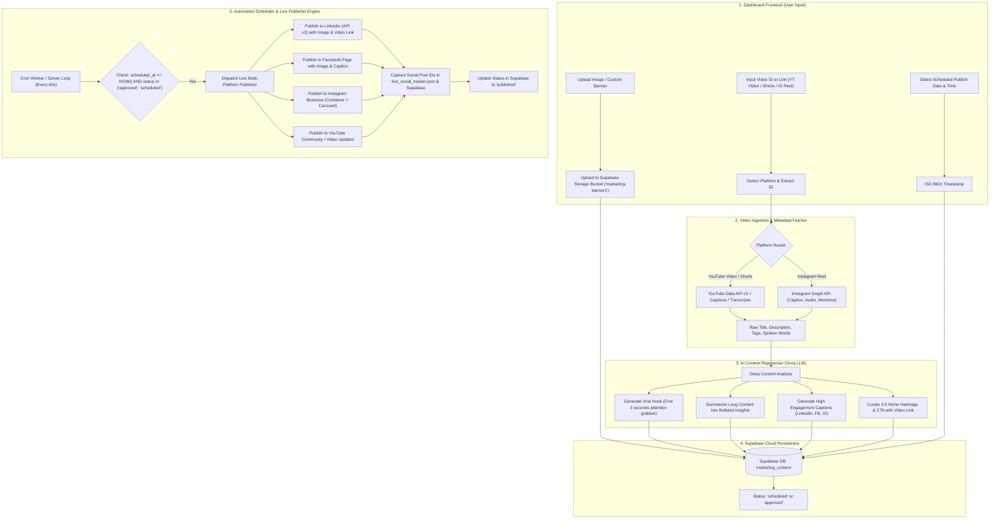
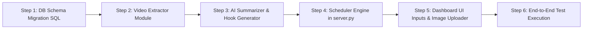

# Comprehensive Implementation Plan: Multi-Channel Video Repurposing & Scheduled Auto-Publisher

---

## 1. Executive Architecture Overview

This project transforms existing videos (YouTube Long-form, YouTube Shorts, or Instagram Reels) into high-impact, cross-platform social media campaigns published automatically at user-defined scheduled times.



---

## 2. Supabase Database Schema Updates

To support video analysis, uploaded media, and timestamp-based scheduling, the `marketing_content` table schema will be updated with the following definition:

```sql
-- Migration: Add Video & Scheduling Fields to marketing_content
ALTER TABLE public.marketing_content 
    ADD COLUMN IF NOT EXISTS video_id TEXT,
    ADD COLUMN IF NOT EXISTS video_platform TEXT CHECK (video_platform IN ('youtube', 'youtube_shorts', 'instagram_reel', 'manual')),
    ADD COLUMN IF NOT EXISTS video_url TEXT,
    ADD COLUMN IF NOT EXISTS image_url TEXT,
    ADD COLUMN IF NOT EXISTS hook TEXT,
    ADD COLUMN IF NOT EXISTS summary TEXT,
    ADD COLUMN IF NOT EXISTS scheduled_at TIMESTAMPTZ,
    ADD COLUMN IF NOT EXISTS published_at TIMESTAMPTZ,
    ADD COLUMN IF NOT EXISTS social_post_ids JSONB DEFAULT '{}'::jsonb;

-- Index for instant lookup of due scheduled posts
CREATE INDEX IF NOT EXISTS idx_marketing_content_scheduled 
    ON public.marketing_content (status, scheduled_at) 
    WHERE status IN ('approved', 'scheduled');
```

---

## 3. Video Content Extraction Engine (`video_extractor.py`)

A unified module that accepts any URL or raw ID, detects the platform, and extracts full text content:

### 3.1 YouTube Video & Shorts
- **ID Parser**: Handles `watch?v=ID`, `youtu.be/ID`, and `shorts/ID`.
- **Metadata**: Calls YouTube Data API (`videos?part=snippet,contentDetails&id=...`) with `YOUTUBE_API_KEY`.
- **Transcript/Captions**: Uses YouTube Captions / `youtube-transcript-api` to retrieve spoken dialogue for comprehensive content understanding.

### 3.2 Instagram Reels
- **ID Parser**: Handles `instagram.com/reel/ID` or `instagram.com/p/ID`.
- **Metadata**: Calls Meta Graph API (`/{media-id}?fields=caption,media_type,permalink,thumbnail_url,timestamp`) using `INSTAGRAM_ACCESS_TOKEN`.

---

## 4. AI Content Repurposing & Hook Generator (`ai_processor.py`)

Using the Groq LLM API (`GROQ_API_KEY` with `openai/gpt-oss-120b` or backup key `GROQ_SECONDARY_API_KEY`):

### Output Structure:
```json
{
  "hook": "Stop wasting hours editing social posts — here is the 3-step automation blueprint.",
  "summary": "1. Paste your video ID.\n2. AI extracts key takeaways and hooks.\n3. Automatic scheduling across all channels.",
  "generated_content": "Full platform-optimized post introducing the video and sharing the core lesson...",
  "hashtags": "#ContentAutomation #MarketingTech #GrowthStrategy",
  "call_to_action": "Watch the full breakdown here: https://youtu.be/..."
}
```

---

## 5. Dashboard UI Redesign (`dashboard.html`)

Add a dedicated **"Video Repurposer & Scheduler"** card above the content grid:

1. **Video URL / ID Input**:
   - Auto-detects platform badge (YouTube / Shorts / Instagram).
   - "Fetch & Analyze" button with loading spinner.
2. **Custom Image / Banner Uploader**:
   - Drag-and-drop zone.
   - Uploads directly to Supabase Storage (`marketing-banners`).
   - Fallback button: "Use Video Default Thumbnail".
3. **Smart Date & Time Picker**:
   - Quick presets: "Publish in 1 Hour", "Publish Tonight at 7 PM", "Publish Tomorrow 9 AM", or Custom Date & Time picker.
4. **Live Split-Preview**:
   - Shows live mockups of LinkedIn, Facebook, and Instagram cards before publishing.
5. **Approve & Schedule Button**:
   - Saves record to Supabase with status `scheduled`.

---

## 6. Background Scheduling & Multi-Platform Publisher Engine (`server.py`)

### 6.1 Scheduler Loop (Background Worker)
- Runs every 60 seconds inside `server.py` (or via n8n cron node).
- Queries Supabase:
  ```sql
  SELECT * FROM marketing_content 
  WHERE status IN ('approved', 'scheduled') 
    AND scheduled_at IS NOT NULL 
    AND scheduled_at <= NOW()
  ORDER BY scheduled_at ASC;
  ```
- Triggers `live_publish_to_social(...)` for each due item.

### 6.2 Multi-Platform Publishing Targets
1. **LinkedIn**: Post text + attached custom banner image + link to original video.
2. **Facebook**: Page photo post or feed post with custom image + caption + video link.
3. **Instagram**: Business Container creation with uploaded image + video hook in caption.
4. **YouTube Community**: Updates channel followers with the post image, hook, and video link.

### 6.3 State Sync & Idempotency
- Updates Supabase status to `published` and records `published_at = NOW()`.
- Records live IDs in `live_social_tracker.json` and Supabase `social_post_ids` column for one-click edit/delete sync.

---

## 7. Step-by-Step Implementation Roadmap



1. **Step 1: Schema Migration**
   - Execute the updated SQL in Supabase to add video and scheduling columns.
2. **Step 2: Video Extractor (`video_engine.py`)**
   - Implement YouTube and Instagram fetching with API key fallbacks.
3. **Step 3: AI Hook & Summary Generator**
   - Connect Groq LLM to digest video transcripts and output structured hooks.
4. **Step 4: Scheduled Background Worker**
   - Add the automated timer loop to `server.py` that watches for due posts.
5. **Step 5: Dashboard UI Updates**
   - Add image upload, video input, time picker, and review preview cards.
6. **Step 6: End-to-End Verification**
   - Test with a real YouTube video link and verify scheduling and live publishing.

